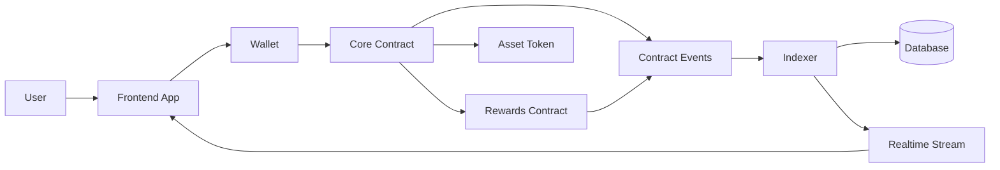
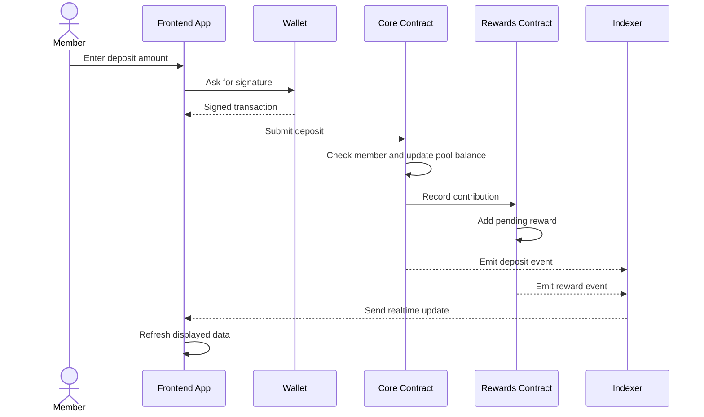
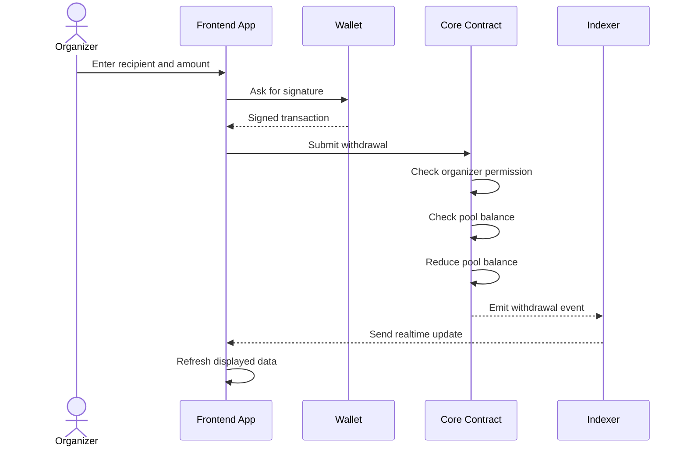
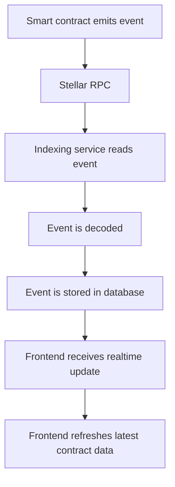
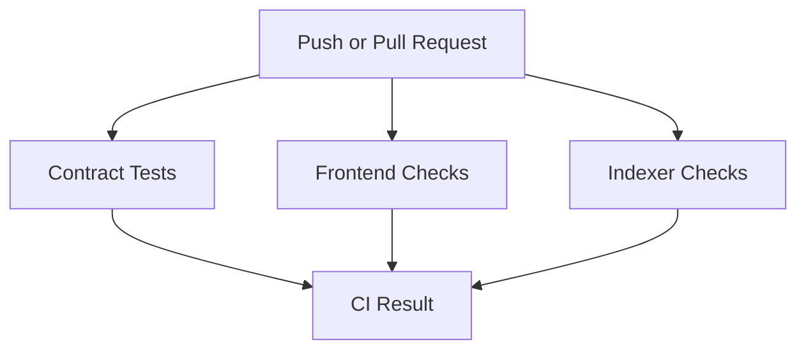

# Builder Belt Level 4: Understanding Talambag

This document is for participants attending the Builder Belt Level 4 discussion. It explains what this level is about, what Talambag built, and how the repository can be used as a reference.

## What Is Builder Belt Level 4?

Builder Belt Level 4 is about moving from a basic blockchain application into a more complete decentralized application.

At this level, builders are expected to understand:

- How smart contracts can call other smart contracts.
- How a project can create and use a custom token.
- How pooled funds work through deposits and withdrawals.
- How frontend apps stay updated when blockchain events happen.
- How CI/CD helps prove the project works.
- How to make the app usable on mobile devices.

## What Is Talambag?

**Talambag** means **Stellar Contribution**. It is a community pooling app built with Soroban smart contracts on Stellar.

The app is designed for groups that collect shared funds, such as families, student organizations, local communities, or fundraising groups.

Instead of tracking contributions through chat messages, screenshots, or spreadsheets, Talambag records the important actions on-chain:

- A user creates a group.
- The group owner adds members.
- Members create contribution pools.
- Members deposit funds into pools.
- Pool organizers withdraw funds when needed.
- The app listens to blockchain events so the frontend updates in near real time.

## Why This Project Fits Level 4

Talambag includes the main requirements of Builder Belt Level 4:

| Level 4 Requirement | How Talambag Shows It |
|---|---|
| Inter-contract calls | The core contract calls the rewards contract when a member contributes. |
| Custom token creation | The rewards contract acts as a custom reward token. |
| Liquidity or pool mechanics | Groups have pools where members can deposit and organizers can withdraw. |
| CI/CD setup | GitHub Actions checks contracts, frontend, and indexer. |
| Mobile responsive design | The frontend supports desktop and mobile layouts. |
| Realtime frontend updates | The indexer streams contract events to the frontend. |
| Complete README | The repository includes setup, architecture, screenshots, and demo references. |

## High-Level Architecture



In simple terms:

1. The user interacts with the frontend.
2. The frontend asks the wallet to sign transactions.
3. The core contract handles groups, members, pools, deposits, and withdrawals.
4. The rewards contract handles reward token balances.
5. Contract events are picked up by the indexer.
6. The indexer sends updates back to the frontend.

## The Two Smart Contracts

Talambag uses two smart contracts because the project has two separate responsibilities.

### 1. Core Contract

The **core contract** is the main application contract.

It handles:

- Creating groups.
- Adding members.
- Creating pools.
- Accepting deposits.
- Allowing organizer withdrawals.
- Tracking pool balances.
- Emitting important events.

Important file:

```text
contracts/src/lib.rs
```

### 2. Rewards Contract

The **rewards contract** handles the reward token system.

It handles:

- Reward token metadata.
- Pending rewards.
- Claimed reward balances.
- Total token supply.
- Reward claims.
- Reward transfers.
- Reward burns.

Important file:

```text
contracts/rewards/src/lib.rs
```

## Why Create A Rewards Token?

The rewards token was added because Talambag is not only about collecting money. It also wants to recognize members who contribute.

When a member deposits into a pool, the core contract records the contribution in the rewards contract. This gives the member pending reward tokens that can later be claimed.

This design is useful because:

- The core contract stays focused on pooling logic.
- The rewards contract stays focused on token logic.
- The project demonstrates real inter-contract calls.
- Rewards can later be used for badges, loyalty points, governance, or community benefits.
- The token has a real purpose instead of being added only to satisfy a requirement.

## How A Deposit Works



The important idea is that one user action affects both contracts:

- The pool balance changes in the core contract.
- The reward balance changes in the rewards contract.

## How A Withdrawal Works



Only the pool organizer can withdraw from a pool. This is enforced by the smart contract, not just by the frontend.

## Realtime Event Streaming

Blockchain apps can feel slow if users need to refresh the page manually. Talambag solves this with an indexer.

The indexer watches contract events and streams updates to the frontend.



Important files:

```text
indexer/src/indexer.ts
indexer/src/normalize-event.ts
indexer/src/server.ts
frontend/src/lib/realtime-events.ts
```

## Frontend Pages

The frontend is a Next.js app.

| Page | What it does |
|---|---|
| Dashboard | Shows all groups and lets users create a group. |
| Group page | Shows group details, members, and pools. |
| Pool page | Shows pool balance, deposits, withdrawals, and rewards. |
| Offline page | Supports PWA behavior when the user is offline. |

Important frontend files:

```text
frontend/src/app/page.tsx
frontend/src/app/groups/[groupId]/page.tsx
frontend/src/app/groups/[groupId]/pools/[poolId]/page.tsx
frontend/src/app/globals.css
```

## CI/CD

Talambag uses GitHub Actions to check the project automatically.



The CI workflow checks:

- Rust contract tests.
- Frontend linting.
- Frontend type checking.
- Frontend production build.
- Indexer type checking.
- Indexer build.
- Optional testnet deployment when secrets are available.

Important file:

```text
.github/workflows/ci-and-deploy.yml
```

## What You Should Be Able To Explain After This Session

By the end of the discussion, you should be able to explain:

1. What Builder Belt Level 4 requires.
2. What Talambag does.
3. Why Talambag uses two smart contracts.
4. How the core contract and rewards contract interact.
5. How deposits and withdrawals work.
6. How contract events reach the frontend.
7. Why CI/CD is important for this level.
8. Which files to inspect in the GitHub repository.

## Suggested Repository Walkthrough

When studying the repository, open these files in this order:

1. `README.md`
2. `.github/workflows/ci-and-deploy.yml`
3. `contracts/src/lib.rs`
4. `contracts/rewards/src/lib.rs`
5. `indexer/src/server.ts`
6. `indexer/src/indexer.ts`
7. `frontend/src/lib/realtime-events.ts`
8. `frontend/src/app/page.tsx`

## Key Takeaways

- Level 4 is about building a more complete dApp, not only writing one smart contract.
- Inter-contract calls help separate responsibilities.
- A custom token is more meaningful when it supports a real app use case.
- Events are important for keeping the frontend synchronized.
- CI/CD helps prove that the contracts, frontend, and backend services still work.
- Mobile responsiveness matters because many users interact with wallets on small screens.

